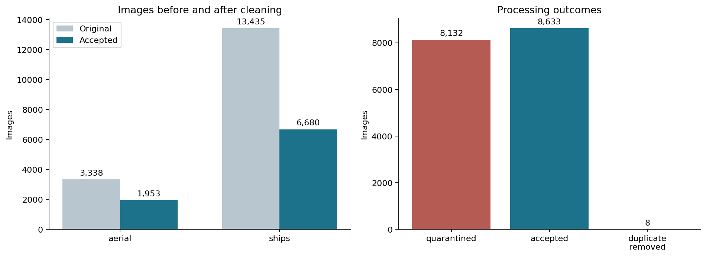
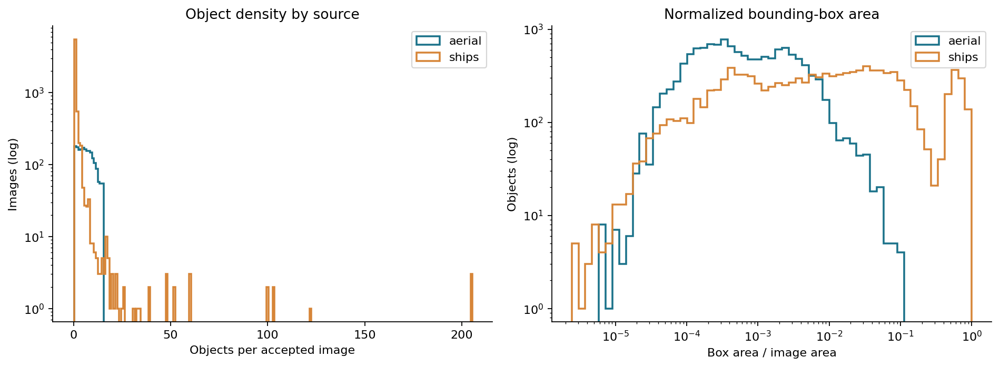

# Maritime vessel detection and geospatial analysis

A reproducible engineering portfolio project for satellite/aerial vessel detection with YOLO, followed by geospatial inference and analysis. The implemented stage prepares, audits and validates a single-class detection dataset. Training and geospatial inference have not started; no accuracy or vessel-location result is claimed.

## Project highlights

- Processed and audited 16,773 satellite and aerial images.
- Curated 8,633 images containing 24,485 vessel annotations.
- Implemented orientation-aware duplicate detection and annotation conflict analysis.
- Developed a reproducible, leakage-aware dataset preparation pipeline.
- Passed 41 automated tests and Ultralytics dataset validation.

**Current status:** Dataset engineering and validation completed. YOLO model training and geospatial inference are planned next stages.


## Dataset overview

The preprocessing pipeline transforms 16,773 raw images
into a curated dataset of 8,633 images containing
24,485 vessel annotations.



## Dataset characteristics

Analysis of image dimensions, object density and
bounding-box distributions.





## Project layout

```text
configs/dataset.yaml           Portable paths and preparation policy
src/dataset_core.py            Annotation conversion, hashes, grouping, splitting
src/prepare_dataset.py         Ingestion, quarantine, export and validation CLI
src/report_dataset.py          Statistical plots, annotation overlays and report
src/verify_artifacts.py        Raw preservation, quarantine and artifact integrity
src/variant_audit.py           Orientation-aware image/annotation conflict audit
src/review_policy.py           Explicit semantic-family and source-pixel exclusions
src/review_evidence.py         Reproducible semantic inspection panels
tests/                        Critical preprocessing and leakage-prevention tests
requirements.txt              Exact package versions used
customdataset.py              Original merge script, preserved unchanged
data/                         Original local assets, preserved unchanged (Git ignored)
  processed/                  Generated YOLO dataset
    images/{train,val,test}/
    labels/{train,val,test}/
    data.yaml
  quarantine/                 Original rejected images/labels in ZIP plus index
reports/
  dataset_preparation.md      Executed preparation report
  summary.json                Counts, archive fingerprints and package versions
  validation.json             Full export and Ultralytics checks
  dry_run.json                Pre-export plan
  figures/                    Distribution plots and annotation examples
  manifests/                  Per-image provenance, original polygons and relations
.cache/                       Fingerprinted ingestion cache (Git ignored)
```

## Local datasets and provenance

- **AerialShipDetectionDataset.zip**: mixed image/TXT directories `train_v2` and `val_v2`, YOLO-style bounding boxes; no test split.
- **ShipsVessels inAerial Images.zip**: `ships-aerial-images/{train,valid,test}/{images,labels}`, class `0: ship`; mixed bounding boxes and polygons. The existing extracted copy is not ingested again.
- `data/ship1.JPG` is outside both datasets and has no annotation; it is excluded.

The archive filenames are local source identifiers, not verified dataset titles or providers. Download URLs, authors, licenses and full sensor/provenance metadata have not been supplied or verified. Obtain and record these before distributing images or asserting usage rights. The existing Kaggle paths in the original Ships YAML establish a historical configuration, not a verified source URL or license. No raw assets are committed by this workflow.

Archives are read directly, so extraction is unnecessary. Image pixels are decoded for inspection but the original compressed image bytes are exported without resizing, recompression or new augmentation. Source SHA-256 fingerprints are recorded and rechecked. All original files, including `customdataset.py`, remain untouched.

## Preparation policy

1. Inventory each archive once; retain source members, former splits, dimensions, file/pixel SHA-256, 64-bit DCT perceptual hash, raw annotations and processing decisions in a JSONL manifest.
2. Quarantine missing annotations and unverified empty annotations; never infer a negative label from absence. Exclude orphan labels from the training dataset while retaining them in quarantine and manifests.
3. Validate finite coordinates, class ID 0, syntax and positive area. Convert valid polygons into enclosing axis-aligned boxes. Clip boundary-crossing boxes in corner space. Quarantine the whole image for any unresolved row, out-of-range polygon, zero-area box, decode failure or nonidentity EXIF orientation.
   Require both clipped box sides to cover at least one source pixel, with a 1e-6 pixel floating-point tolerance. Do not silently drop isolated subpixel objects from otherwise labelled images; quarantine the image for review.
   Clipping is not proof that a box covers the correct object. Reviewed border-crossing examples were mislocalized, so clipped images also require explicit alignment approval in `approved_clipped_image_ids`. No such approvals are provided: geometric repairs remain in the audit/quarantine, with zero unapproved repaired images entering training.
4. Detect exact images by both file and decoded RGB hashes. Keep one canonical copy only when labels agree after conversion/clipping. Quarantine conflicting exact clusters and their normalized-source-name variants. Every removal has a manifest status; no raw data is deleted.
   Compare same-source variants under eight right-angle rotation/reflection alignments as well. Require 64x64 RGB thumbnail MAE <=4/255 and perceptual Hamming distance <=4 to establish near-identical content. Quarantine the entire source-name family if aligned annotations disagree in count or cannot be matched one-to-one with every box IoU >=0.5. Store alignment and disagreement evidence in `reports/manifests/variant_conflicts.jsonl`.
5. Connect related images using exact hashes, normalized source filenames, perceptual Hamming distance <=4, and recognizable parent acquisition IDs in geospatial filenames. Transitive connected components are indivisible split groups. Perceptual matches group images conservatively; they never justify deletion by themselves.
6. Rebuild splits with seed **42**, targeting **80/10/10**. Deterministic greedy allocation and refinement balance image/object counts, source, size, aspect and object-density bins while preserving groups. Prior split names are provenance only. No new augmentation is performed.
7. Export standard YOLO labels, original images, a portable YAML, a quarantine ZIP/index, manifests, report and plots. Validate every exported image and label, then load all splits with Ultralytics and compare its parsed annotations with the manifest.

Original polygon rows remain available in `reports/manifests/original_polygons.jsonl`, the full manifest and untouched source archives. The quarantine ZIP holds rejected originals; matching raw labels are included when present. Valid redundant duplicates remain in the untouched raw archives and are identified by `duplicate_of` in the manifest.

Visual inspection found cloud/non-vessel regions labelled as class 0 in some `frederikshavn` and `3b_visual` source-name families. Their original class semantics cannot be verified, so explicit rules in both configs quarantine all matching Ships records pending review. This conservative decision can exclude valid vessel examples; it does not assert that all matching annotations are wrong. `reports/review/semantic_review.png` and its source-member index are reproduced by `src/review_evidence.py`. `manifests/review_decisions.jsonl` records every policy exclusion. No guessed class remapping is applied.

## Reproduction

Use Python **3.12** and run from the project root. Install the recorded dependencies in a clean virtual environment:

```powershell
python -m venv .venv
.\.venv\Scripts\python.exe -m pip install -r requirements.txt
.\.venv\Scripts\python.exe -m pytest -q -p no:cacheprovider
.\.venv\Scripts\python.exe -u -m src.prepare_dataset --dry-run
.\.venv\Scripts\python.exe -u -m src.prepare_dataset
.\.venv\Scripts\python.exe -m src.verify_artifacts
```

For the initial local execution, the dedicated environment was created with `python -m venv --system-site-packages .venv` to reuse the already-installed dependencies. Exact imported versions are recorded in `reports/summary.json`; no missing dependency installation was needed.

Both archives must be present at the paths in `configs/dataset.yaml`. Paths resolve against the repository root, independently of the shell's working directory. To use another location inside the project, pass `--config path/to/config.yaml` with the same schema.

The dry run writes a plan, manifest and reusable ingestion cache; it does not export images. Actual export must reproduce that plan. The pipeline refuses to overwrite an existing output or quarantine ZIP. For a fresh independent reproduction, choose new `output`, `quarantine` and `reports` directories in a copied config, then run both preparation commands with `--config`. Do not delete or overwrite raw datasets. Cache validity depends on source hashes, processing code and image-library versions.

The supplied `configs/reproduce.yaml` already selects independent destinations, so these exact commands can reproduce the preparation beside the completed export:

```powershell
.\.venv\Scripts\python.exe -u -m src.prepare_dataset --config configs/reproduce.yaml --dry-run
.\.venv\Scripts\python.exe -u -m src.prepare_dataset --config configs/reproduce.yaml
.\.venv\Scripts\python.exe -m src.verify_artifacts --config configs/reproduce.yaml
```

Those destinations must not already exist. The fingerprinted ingestion cache can be reused without changing the resulting split; delete neither source archives nor the existing processed dataset. An uncached reproduction uses a new `cache` path in the config.

Revalidate an existing export and regenerate figures:

```powershell
.\.venv\Scripts\python.exe -u -m src.prepare_dataset --validate-only
.\.venv\Scripts\python.exe -m src.report_dataset
.\.venv\Scripts\python.exe -m src.verify_artifacts
```

The test suite covers corner-space clipping, polygon conversion, invalid coordinates/classes, mixed annotations, missing/empty labels, exact-conflict quarantine, canonical duplicates, Hamming-tree lookup and deterministic group allocation.

It also tests all eight orientation alignments, corresponding box-coordinate transforms, unordered IoU matching, end-to-end rotated annotation-conflict quarantine, descriptor-cache reproducibility and Windows rename recovery. Thumbnail comparison can conservatively quarantine legitimate variants and cannot verify every semantic annotation; the thresholds and pair evidence are reported.

## Final statistics and validation

The final approval-gated run retained **8,633 images / 24,485 objects**, with seed 42 and whole-group splitting:

| Split | Images | Objects |
|---|---:|---:|
| Train | 6,906 | 19,595 |
| Validation | 864 | 2,442 |
| Test | 863 | 2,448 |
| Total | 8,633 | 24,485 |

Of 16,773 input images, **8,132 were quarantined** and **8 consistent exact duplicates were removed**. Quarantine reasons overlap: 863 missing labels, 470 unverified empty labels, seven invalid-annotation images, exact/related conflicts, 5,284 images in source-name families with orientation-aware annotation conflicts, 634 images with subpixel rows, 534 images in unverified semantic families and 1,403 images whose clipped annotations require review. One orphan label was excluded from the processed dataset. The final dataset retains **673 converted polygons**. **1,573 boxes were geometrically repaired during inspection; zero repaired boxes were accepted without image-level alignment approval.** All original polygon rows remain preserved, including rejected examples.

**41 automated tests passed.** Full exported image/label checks and independent file/pixel/group/source-name/recognized-scene/perceptual leakage checks passed with zero known cross-split leakage. Ultralytics loads all three splits and matches their parsed annotations to the export. Readiness means technical usability for an initial single-class experiment; semantic annotation quality, negatives, geographic independence and license verification remain limitations.

Intermediate exports were superseded after visual review found additional annotation and semantic issues. They remain under `data/intermediate/` for traceability and must not be used as the final dataset. Final artifacts are under `data/processed/`.

The completed run's authoritative statistics are in [the preparation report](reports/dataset_preparation.md), [summary.json](reports/summary.json) and [validation.json](reports/validation.json). These contain images and objects per split, source balance, exclusions, repairs, duplicate handling and the assignment digest. The figures include cleaning distributions, object density, bounding-box areas, image dimensions, annotated examples from both sources and before/after clipping examples.

## Local YOLO and Google Colab

`data/processed/data.yaml` uses relative `images/train`, `images/val` and `images/test` entries and omits an absolute `path`. Transfer the entire processed directory together, preserving its internal layout. Pass the resulting YAML's absolute path to Ultralytics. Neither this pipeline nor validation starts training or downloads model weights.

For a CPU environment, the listed Torch package is sufficient for preparation and loader validation. Select the appropriate official PyTorch CUDA build separately when planning GPU training; that environment must be recorded independently.

Ultralytics may create label `.cache` files beside generated labels; these are derived files and Git ignored. Its project-local settings are also ignored.

If Windows interrupts the staging-directory rename, the pipeline retries transient locks. After an interrupted completed export, `python -m src.prepare_dataset --resume-export` regenerates metadata and performs full validation against the same dry-run plan without overwriting image/label files. An incomplete export fails validation and is never reported as ready.

## Known limitations and planned stages

- Excluding unverified negatives produces a positive-only dataset. False-positive evaluation requires verified negative scenes.
- Perceptual/name grouping can over-group similar images and miss strong crops, rotations or other variants. Geospatial scene identifiers only cover some files. No complete geotransforms, CRS, timestamps or footprints are available, so zero **known group leakage** does not prove geographic independence.
- Geometry validation and clipping cannot establish semantic annotation quality. Conflicting labels in the inputs justify a systematic human overlay review before serious modeling.
- Unapproved clipped images are withheld, and semantic-family exclusions can remove correct examples. These conservative policies reduce boundary-case/source coverage and introduce selection bias; quarantined records need human annotation review before reinstatement.
- Polygon conversion loses orientation and shape, while imagery mixes scales and resolutions without verified ground sampling distance. Vessel size in meters cannot be derived from these JPEGs alone.
- License/provenance verification remains outstanding. A technically valid local dataset is not a claim of redistribution rights or benchmark quality.

Next stages: verify provenance/licenses; review labels and add negatives; establish a fixed YOLO baseline and test protocol; add georeferenced inference, overlap-aware tiling and merging; map detections to geographic coordinates; evaluate detection accuracy, spatial errors and uncertainty. None of these future results is claimed as completed.

## Implementation references

- [Ultralytics dataset utilities](https://docs.ultralytics.com/reference/data/utils/)
- [Ultralytics YOLODataset API](https://docs.ultralytics.com/reference/data/dataset/)

These describe the YAML resolution and dataset-loader interfaces used for validation; they are not sources for the local datasets.
