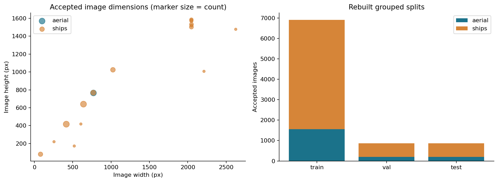

# Maritime vessel detection and geospatial analysis

The goal of this project is to detect and analyze ships in satellite and aerial imagery using deep learning. By combining Python, computer vision and YOLO, the project aims to identify vessels, determine their geographic locations and analyze maritime traffic and port congestion.

## Project highlights

- Processed and audited 16,773 satellite and aerial images.
- Curated 8,633 images containing 24,485 vessel annotations.
- Implemented orientation-aware duplicate detection and annotation conflict analysis.
- Developed a reproducible, leakage-aware dataset preparation pipeline.
- Passed 41 automated tests and Ultralytics dataset validation.

**Current status:** Dataset engineering and validation completed. YOLO model training and geospatial inference are planned next stages.

## Representative vessel annotations

Examples of maritime vessels in satellite and aerial imagery,
with ground-truth bounding box annotations.

## Dataset overview

The preprocessing pipeline transforms 16,773 raw images
into a curated dataset of 8,633 images containing
24,485 vessel annotations.

## Dataset characteristics

Analysis of image dimensions, object density and
bounding-box distributions.

## Project workflow

The project combines computer vision, remote sensing and geospatial analysis to detect and analyze maritime vessels from satellite and aerial imagery.

The dataset preparation pipeline consists of the following steps:

1. Collect and combine two maritime imagery datasets.
2. Standardize annotations into the YOLO bounding box format.
3. Identify duplicate images and inconsistent annotations.
4. Filter unreliable data and assess annotation quality.
5. Create training, validation and test splits while minimizing data leakage.
6. Validate the final dataset for YOLO training.

## Dataset preparation results

| Split | Images | Vessel annotations |
|---|---:|---:|
| Training | 6,906 | 19,595 |
| Validation | 864 | 2,442 |
| Test | 863 | 2,448 |
| **Total** | **8,633** | **24,485** |

From the original 16,773 images, 8,132 were excluded due to annotation or quality concerns, and 8 redundant duplicates were removed.

The pipeline passed **41 automated tests**, with no detected cross-split data leakage.

## Technologies

- Python
- Ultralytics YOLO
- Computer vision and image processing
- Perceptual hashing and image similarity analysis
- NumPy and Matplotlib
- Pytest

## Project structure

- `src/` — Dataset preparation, image processing and validation.
- `configs/` — Dataset and pipeline configurations.
- `tests/` — Automated tests.
- `reports/` — Statistical analysis, figures and validation results.

Detailed results are available in the [dataset preparation report](reports/dataset_preparation.md).

## Limitations

This project is currently in development. Model training and geospatial inference have not yet been completed.

Further annotation review and dataset license verification are required. Original datasets are not distributed through this repository.