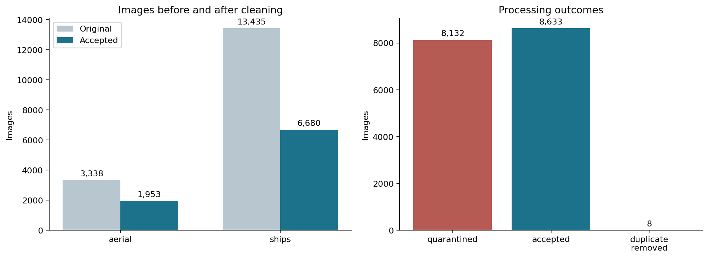
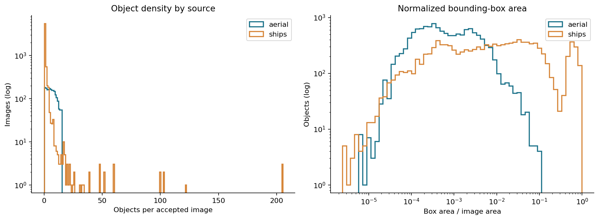
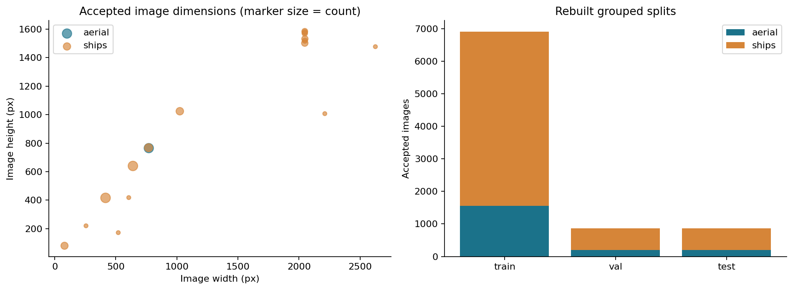
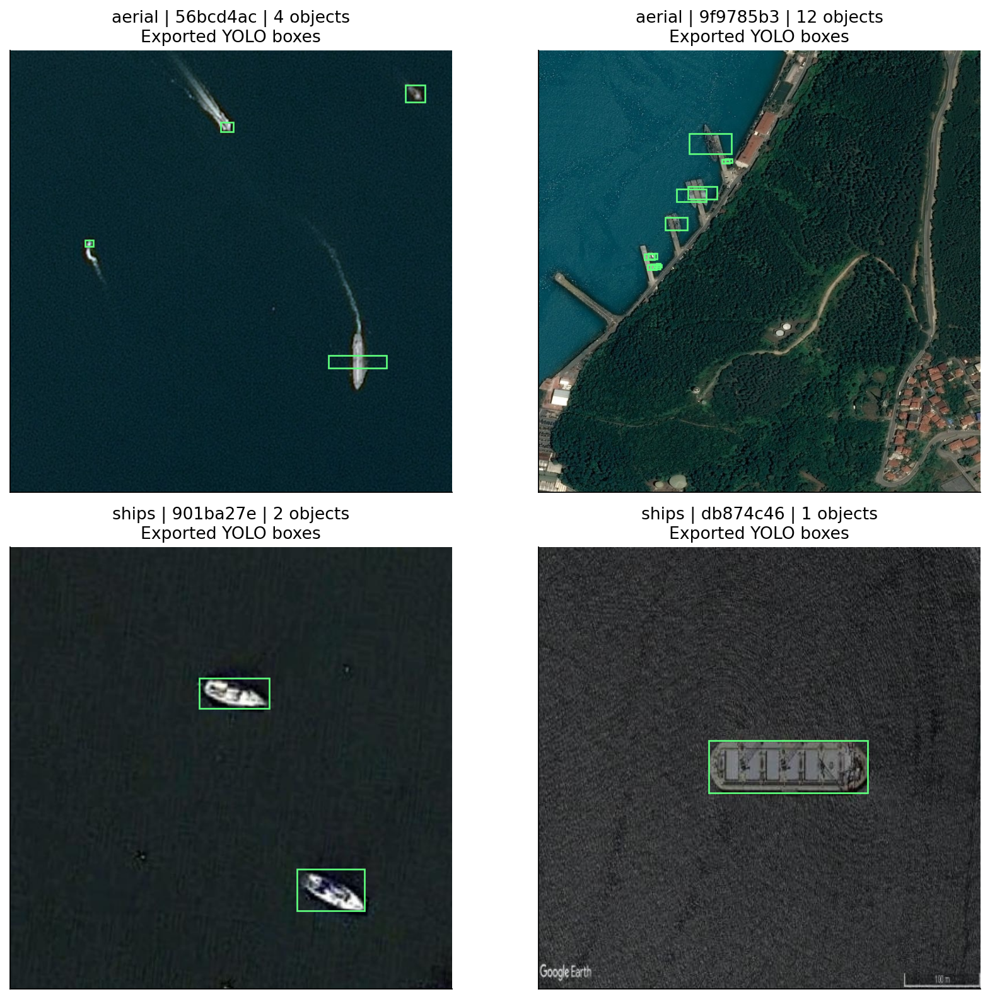
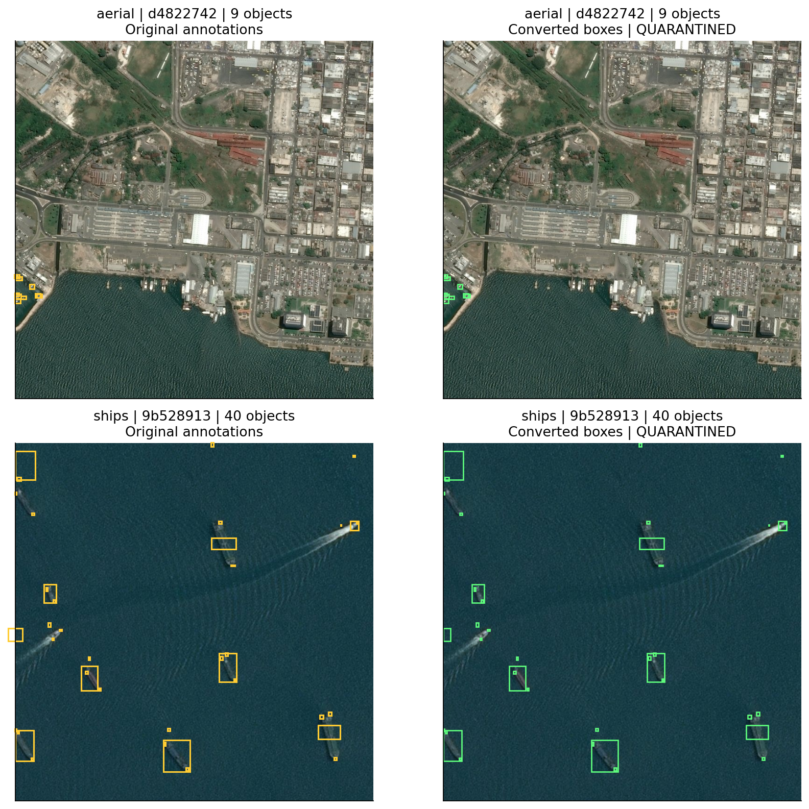
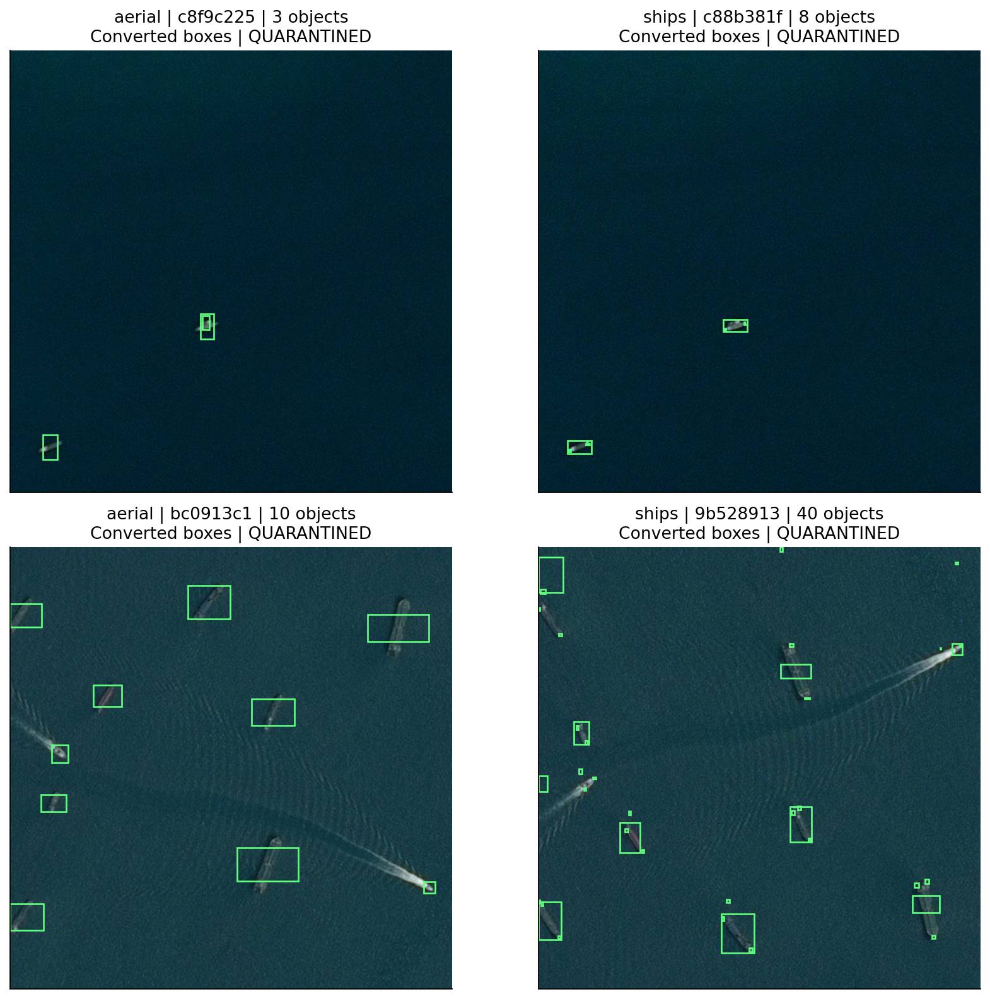
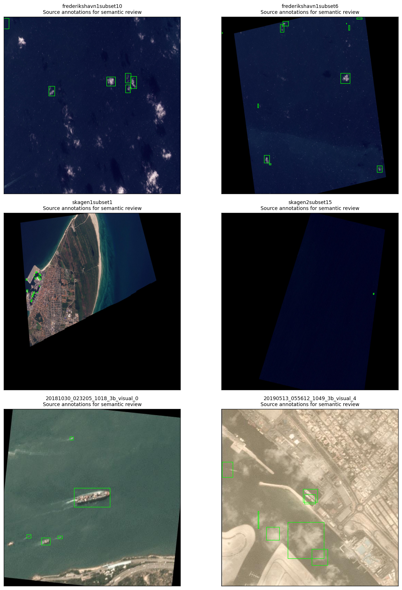

# Dataset preparation report

This report describes an executed preparation run, not a model evaluation. Seed: **42**. Target split: **80/10/10**, with whole related-image groups taking precedence.

## Input inventory

| Source | Original split | Images | Label files | Object rows |
|---|---|---:|---:|---:|
| aerial | train_v2 | 3,202 | 2,453 | 16,775 |
| aerial | val_v2 | 136 | 23 | 175 |
| ships | test | 1,573 | 1,573 | 2,872 |
| ships | train | 9,697 | 9,697 | 19,456 |
| ships | valid | 2,165 | 2,165 | 3,720 |

Original dataset images: **16,773**. Original object rows: **42,998**, including orphan-label rows. The Ships extracted copy is not ingested. `data/ship1.JPG` has no verified annotation/provenance and is excluded. Source URLs and licenses are unverified.

## Cleaning decisions and outcomes

- Accepted: **8,633 images**, **24,485 objects**.
- Quarantined: **8,132 images** in `data/quarantine/quarantined.zip`, with original labels where present and a separate index.
- Removed redundant exact duplicates: **8 images**. Canonical copies are recorded in the manifest; originals remain in source archives.
- Orphan annotations excluded from export: **1**, retained in quarantine and the orphan manifest.
- Polygons converted and retained in the final dataset: **673**; successfully converted during inspection: **675**.
- Bounding boxes clipped and retained: **0**; clipped during inspection: **1,573**. Clipping uses corner-space intersection with the image.
- Duplicate converted object rows collapsed in accepted labels: **0**.
- Missing labels and unverified empty labels are never treated as negatives. Any unresolved row invalidates the entire image. Nonidentity EXIF orientation is quarantined rather than guessing coordinate conventions.
- Exact-image annotation disagreements are quarantined along with same-source-name variants. No conflicting label set is selected arbitrarily.
- Same-source variants are also compared under all eight right-angle rotation/reflection alignments. A 64x64 RGB thumbnail MAE <=4/255 and perceptual Hamming distance <=4 establish conservative near-identical-content evidence. Matched images with unequal object counts or a best one-to-one box matching IoU below 0.5 trigger quarantine of the entire source-name family. This is not an attempt to guess which annotation set is correct.
- Post-clipping boxes must have both sides >=1 source pixel (1e-6 pixel tolerance). Images with subpixel rows are quarantined as unresolved annotations, rather than silently dropping only their small objects.
- Border-crossing labels are geometrically clipped, but require explicit image-level annotation-alignment approval before export. Visual review found mislocalized examples whose semantics clipping could not fix. No clipped-image approvals were available, so repaired cases remain quarantined. The repair figure illustrates geometry conversion of rejected originals, not approved training labels.
- Explicit source-family review exclusions quarantine unverified class semantics identified in image overlays. These are documented policy decisions, not inferred class remappings. Rule definitions and per-image decisions are preserved in the configuration and `manifests/review_decisions.jsonl`.
- Original polygon text and per-row conversions/repairs are preserved in `manifests/original_polygons.jsonl` and the full manifest.

Reasons below are nonexclusive; their counts must not be summed as a unique image total.

| Quarantine reason | Images |
|---|---:|
| clipped_annotation_requires_review | 1,403 |
| missing_annotation | 863 |
| exact_duplicate_annotation_conflict | 40 |
| transformed_duplicate_annotation_conflict | 5,284 |
| unverified_empty_annotation | 470 |
| subpixel_annotation | 634 |
| related_annotation_conflict | 30 |
| unverified_semantic_annotation_family | 534 |
| invalid_annotation | 7 |

## Final splits

| Split | Images | Objects | Aerial images | Ships images | Groups |
|---|---:|---:|---:|---:|---:|
| train | 6,906 | 19,595 | 1,563 | 5,343 | 4,325 |
| val | 864 | 2,442 | 195 | 669 | 539 |
| test | 863 | 2,448 | 195 | 668 | 537 |

Accepted groups: **5,401**; largest accepted group: **1,079 images**. Greedy allocation with deterministic refinement balances total images, objects, source, image size, aspect and object-density bins. No images are augmented, resized or recompressed during export.

`distributions.json` records per-split source/size/aspect/density bins, exact image dimensions and objects-per-image counts. Large indivisible groups can prevent exact balance in individual characteristics even when the overall 80/10/10 target is closely met.

## Leakage prevention and validation

- Exact duplicate clusters in the raw inputs: **32**; clusters with conflicting or unresolved annotations: **20**. One Aerial pair lacks labels on both copies; the 19 Ships pairs have numeric annotation disagreements.
- Relations: `{"file_sha256": 32, "normalized_source_name": 5565, "parent_scene": 66, "perceptual": 1435, "pixel_sha256": 32}`. These are recorded union evidence edges, not an exhaustive count of all pairwise similarities.
- Normalized original filenames identify **28** candidate source groups shared between the two datasets. These are grouped globally, rather than relying on dataset-specific prefixes. No exact cross-dataset image match was found in the initial audit.
- Orientation-aware investigation compared **7,867 pairs** across **3,841 source-name groups**. It found **4,094 near-identical aligned pairs**, of which **2,566** had incompatible annotations. This quarantined **5,284 images** in **2,530 families**. Pair-level evidence is in `manifests/variant_conflicts.jsonl`.
- Source-pixel review flagged **1,099 subpixel rows** across **634 input images**. Semantic-family review flagged **534 input images**. These counts overlap other exclusion reasons. No such flags remain in the accepted export.
- Visual review showed boxes on clouds/non-vessel regions in named source families; matching families are held out pending verification. Some matching images contain correct vessel annotations, so this is a conservative exclusion. Exact rules and decisions remain in the configuration, `summary.json` and `manifests/review_decisions.jsonl`.
- Clipped images awaiting alignment approval: **1,403 input images**. Their repairs are retained in the row audit and review figures, while accepted images contain no unapproved repairs.
- Final exact duplicate leakage: **0**; final known related-group leakage: **0**.
- Independent accepted-image rescans also found zero normalized-source-name, recognized-parent-scene or perceptual-radius overlap across splits.
- All exported images decoded and matched their source file/pixel hashes. Every label was checked for positive area, in-image geometry, finite values, detection syntax and class ID 0.
- Split recomputation and reversed-input-order recomputation matched. Assignment SHA-256: `2eba1b32fc9eace08666ec73fa2678d91a29a4554a0c1c1b128a096106e033c4`.
- Ultralytics **8.4.13** loaded all three splits, matched every parsed annotation and loaded three transformed dataset items per split with augmentation disabled. No model was loaded or trained.
- Source archive SHA-256 values and package versions are recorded in `summary.json`; full source members, hashes, annotations, statuses and split assignments are in `manifests/images.jsonl`.

## Figures

`visualization_examples.json` identifies the source image behind every example. Figure overlays are inspection artifacts; they do not modify dataset pixels.

`review/semantic_review_images.json` records the exact source members behind the review panel. The panel is regenerated from the raw archives by `src/review_evidence.py`.

## Limitations and next steps

- Dataset origins, download URLs and licenses were not supplied in the archives and are unverified. Do not claim redistribution rights; obtain and record the original providers' terms before publishing imagery.
- This is a positive-only detection dataset: empty annotations were not verified as negatives and were excluded. Background performance and false-positive rates will require an independently annotated negative set.
- Filename normalization and 64-bit DCT perceptual hashes (Hamming radius 4) provide conservative grouping, not proof of common provenance. Perceptual matches can over-group visually similar water/ships and miss rotations, strong crops, color changes and other transforms. Transitive matches can produce large groups.
- Geographic acquisition IDs are grouped when recognizable in filenames. No reliable CRS, raster geotransforms, scene footprints or complete provenance are supplied. Spatial/temporal independence cannot be guaranteed for records without metadata, or nearby acquisitions with different IDs. This is not yet a georeferenced vessel-location product.
- The original train/validation/test designations are provenance only; all splits were rebuilt. Existing evaluation benchmarks are not preserved.
- Polygon-to-axis-aligned-box conversion loses shape/orientation information. Original polygon rows remain in the manifest, the polygon JSONL and the untouched archives.
- Clipping fixes geometric bounds but cannot prove the original localization was correct. Duplicate-image label disagreements show source annotation quality issues; a systematic human overlay review remains necessary.
- Requiring approval for clipped images and excluding unverified semantic families can remove correct examples. This reduces boundary-case/source coverage and introduces selection bias. No clipped-image approvals were available in this run.
- Sources contain varied image scales/resolutions and likely different sensors. No verified ground sampling distances are available. Object size in pixels is not vessel size in meters.
- Automated validity and loader checks establish technical usability, not detector performance. No model was trained and no accuracy result is claimed.

Obtain dataset licenses/provenance, conduct a human annotation review, add verified negatives and georeferenced imagery, then establish a fixed baseline training/evaluation protocol. Geospatial inference, tiling, vessel mapping and metric evaluation are planned stages, not implemented results.
